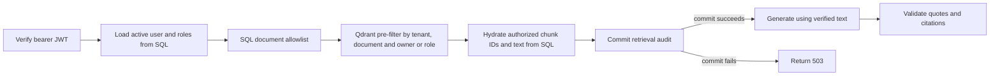

# Permission-Aware Multi-Tenant RAG

This document-assistant API supports private TXT and PDF uploads, tenant-scoped
search, and grounded answers with citations to authorized documents.

## How a question is answered



## Benchmark & Security Results

The local evaluation uses two fictional tenants, six authenticated personas,
six TXT uploads and eight indexed chunks. The employee can read the policy and
runbook, HR can read the policy and salary sheet, and the admin can read all
three through ownership or grants. Each salary sheet spans two chunks. One
complete run on Windows produced these results.

| Metric | Verified local result |
|---|---:|
| Adversarial requests across search and RAG | 100 |
| Responses containing a forbidden document ID, chunk ID or restricted text marker | 0 |
| Raw vector search, p50 / p95 | 0.705 / 1.077 ms |
| ACL-filtered vector search, p50 / p95 | 1.488 / 1.969 ms |
| Paired filtering overhead, p50 / p95 | 0.721 / 1.365 ms |
| Full authenticated and audited search, p50 / p95 | 26.217 / 29.116 ms |
| Full search minus paired raw search, p50 / p95 | 25.413 / 28.208 ms |
| Revoke call to first blocked search response, Acme / Globex | 54.358 / 48.770 ms |

The matrix covers eight cases for each persona on both endpoints, plus four
post-revocation requests. It checks the complete response for restricted text
and IDs, checks every returned ID pair, and verifies that search still returns
the expected authorized chunks. A positive control also requires HR to receive
a salary citation before revocation. Spoofed body fields must produce 422.

Latency uses 100 warmed, alternating pairs on the same query vector and store.
The filtered path includes the application's vector ACL drift check and filtered
ranking. Percentiles use nearest rank on individual samples and on pairwise
differences. SQL allowlist construction, authentication, text hydration, audit,
generation and HTTP are outside this vector timing. After each pair, the
runner times a complete authenticated request to `/retrieval/search` through
the HTTP client, including SQL and audit persistence. Each revocation timing
includes the SQL commit, Qdrant sync and the next authenticated search. RAG
is checked immediately afterward. SQLite, local Qdrant and the extractive model
make the run reproducible offline. Local Qdrant does not exercise server-side
payload indexes. Use staging measurements to size a deployment.

### Run the demo and evaluation

After installing the project with its dev dependencies, run from the checkout:

```powershell
python -m scripts.seed_demo
python -m scripts.run_benchmarks
python -m scripts.run_benchmarks --format json --samples 100
pytest -q tests/test_adversarial_leakage.py
```

Each local command creates its own disposable SQLite database with foreign keys,
in-memory Qdrant and temporary private uploads. The benchmark seeds its own
corpus, logs in over HTTP, and runs the application routes. Markdown is the
default output. A leak or failed positive control gives a nonzero exit code.

### Dedicated Docker Compose staging

From the checkout, with Docker Desktop running Linux containers, run:

```powershell
.\scripts\start-demo.ps1 -SwitchApi
```

The runner builds a separate Compose project named `rag-demo`, waits for MySQL,
migrates `rag_demo` to the current Alembic head and seeds `rag_demo_chunks`
through the real upload API. All Python commands run inside the demo API image.
It creates an ignored `.env.demo.local` on first use with separate random MySQL,
JWT and demo secrets. Keep this file for subsequent starts. Re-running verifies
existing documents and reapplies the demo grants.

Open [Swagger UI](http://127.0.0.1:8000/docs). The terminal prints one login JSON
object and a short-lived bearer token for each persona. Paste an object into
`POST /auth/login` to get a fresh token. In **Authorize**, paste the token value
without the `Bearer ` prefix. Try `POST /rag/query` with
`{"query":"What is the salary band?"}` as Acme HR and then as Acme employee.

The demo API binds to loopback port 8000. `-SwitchApi` allows the runner to
pause an API from this checkout already using that port. It leaves the primary
MySQL and Qdrant services running. The demo has its own volumes, uses
`mysql:3306` and `qdrant:6333` internally, and publishes their host loopback
ports at 13307 and 16333. Host-side database URL edits are unnecessary.

```powershell
.\scripts\start-demo.ps1 -Stop
# If you switched away from the original API, restore its existing container.
docker compose start api
```

To run the full benchmark against the running demo from PowerShell:

```powershell
$key = (Select-String -LiteralPath .env.demo.local -Pattern '^DEMO_PASSWORD_KEY=(.+)$').Matches[0].Groups[1].Value
try {
    $env:DEMO_PASSWORD_KEY = $key
    docker compose -f docker-compose.yml --env-file .env.demo.local -p rag-demo exec -T -e DEMO_PASSWORD_KEY api python -m scripts.run_benchmarks --staging-url http://127.0.0.1:8000
} finally {
    Remove-Item Env:DEMO_PASSWORD_KEY
    Remove-Variable key
}
```

The benchmark writes retrieval audits and temporarily revokes and restores
each HR salary grant. A MySQL advisory lock serializes corpus tools.

## Limitations & Production Roadmap

- PDF extraction runs with the API's filesystem privileges. Isolate the parser
  in a non-root, network-disabled worker with bounded IPC, resource limits and
  no database credentials or original-file mount before accepting untrusted PDFs.
- Upload concurrency is bounded per process. Shared tenant storage quotas and
  replica-wide admission need transactional reservations, expiry, reconciliation
  and capacity alerts. Both designs are detailed under capacity planning below.
- These results cover the specified corpus and access matrix. Production
  latency, larger tenant allowlists and external generation need separate evaluation.

## Prerequisites

- Python 3.11 or newer
- Docker Desktop (optional, for containers)

## Local setup (PowerShell)

```powershell
py -3.11 -m venv .venv
.\.venv\Scripts\Activate.ps1
python -m pip install --upgrade pip
pip install -e ".[dev]"
if (-not (Test-Path .env)) { Copy-Item .env.example .env }
# Edit .env and replace the MySQL password placeholders and JWT secret.
# Generate a secret, for example: python -c "import secrets; print(secrets.token_urlsafe(32))"
uvicorn app.main:app --reload
```

The API is available at `http://127.0.0.1:8000`.

## Health check

In another PowerShell window, run:

```powershell
Invoke-RestMethod http://127.0.0.1:8000/health
```

Expected response:

```json
{"status":"ok","environment":"development"}
```

Interactive API documentation is available at `http://127.0.0.1:8000/docs`.

## Authentication endpoints

`POST /auth/login` accepts `tenant_id`, `email`, and `password`, then returns a
short-lived bearer token for an existing active user. `GET /auth/me` requires
that bearer token and returns the authenticated user ID, tenant ID, and current
database-resolved roles.

Validation errors return field locations and static messages without submitted
values. Login performs an Argon2 check for unknown and disabled accounts. Timing
can still vary, and the API currently has no login rate limiting.

## Document metadata endpoints

`POST /documents` creates a metadata record owned by the authenticated user.
`GET /documents` and `GET /documents/{document_id}` return only documents the
authenticated user owns or can read through an existing role-based permission.
Responses never expose storage keys or file contents. Creation prepares response
fields before commit. A lost commit acknowledgement or HTTP response can still
leave the caller uncertain whether creation succeeded. Repeating a POST can
create another metadata record.

Trusted operators administer role-based read grants with the maintenance command
described below. The tenant admin role grants access to audit queries. Document
reads still require ownership or a role grant.

## Upload and chunking

`POST /documents/upload` takes a bearer token, an `X-Filename` header containing
a base filename (up to 255 characters), and the original file bytes as the HTTP
body. Use `Content-Type: text/plain` for a UTF-8 `.txt` file or
`Content-Type: application/pdf` for a `.pdf` file. This endpoint uses a raw
binary body so it can authenticate before reading the file and enforce its limit
as bytes arrive, including requests without Content-Length.

PowerShell example using an existing token and a local file of your choice:

```powershell
$file = Get-Item -LiteralPath (Read-Host "Path to your TXT file")
Invoke-RestMethod -Method Post -Uri http://127.0.0.1:8000/documents/upload `
  -Headers @{ Authorization = "Bearer $token"; "X-Filename" = $file.Name } `
  -ContentType "text/plain" -InFile $file.FullName
```

A successful request returns 201 and the same public metadata fields as document
creation. Tenant and owner come from the authenticated principal. Chunks share
the document's current access rules through their same-tenant foreign key.
Original files, storage identifiers, paths and chunk bodies are private.

| Environment variable | Default | Meaning |
|---|---|---|
| `MAX_UPLOAD_BYTES` | 5242880 | Maximum raw file size, configurable up to 32 MiB |
| `UPLOAD_DIR` | `~/.permission-aware-rag/uploads` | Local private storage. Supply an absolute path on the host. Compose mounts the dedicated `document_uploads` volume at `/var/lib/rag/uploads`. |
| `CHUNK_SIZE` | 1000 | Window size in Unicode characters, from 1 through 8192 |
| `CHUNK_OVERLAP` | 100 | Characters shared by adjacent windows, at most 75% of the window size |

TXT decoding accepts a UTF-8 BOM and rejects binary control characters. Both
formats must yield at least one letter or digit. PDF extraction uses a strict
pypdf reader in a separate process, with a 15-second timeout, a 200-page limit,
and a 384 MiB address-space ceiling on Linux. Encrypted and image-only PDFs are
rejected. Extraction follows the PDF text layer's order and joins pages with a
newline. OCR and visual layout reconstruction are outside this phase.

Extracted text is limited to one million characters. Chunk windows advance by
size minus overlap and stop once a window reaches the end. Whitespace-only
windows are skipped. Before allocation, at most 4096 windows and an 8 MiB upper bound on generated UTF-8 bytes are allowed. The estimate charges four bytes per character, including overlap. Each new
chunk stores its ordered index, text, SHA-256 of its UTF-8 bytes, and the count
of whitespace-delimited tokens. A UUID links each SQL chunk to its Qdrant point.
The API performs extraction, chunking and indexing during the upload request.

| HTTP status | Meaning |
|---|---|
| 401 | Authentication failed |
| 408 / 413 | Body took over 60 seconds or exceeded the byte limit |
| 415 | Unsupported extension or mismatched media type |
| 422 | Invalid filename, unusable text, malformed/encrypted PDF, or extraction/chunk limit exceeded |
| 500 | Processing or persistence failed |
| 503 | Both upload slots in this API worker are busy |

**Persistence and retries.** Each successful POST creates a separate document,
including repeated bytes or filenames. The storage service creates an exclusive
opaque file in a tenant-specific directory, flushes it to disk, then commits the
document and all chunks together. Extraction failures create no file. Ordinary
write failures roll back and remove the new file. On a commit error the service
checks the primary database before deleting the file. If the outcome cannot be
verified, the file is retained. A crash, power loss or cleanup failure can require
manual reconciliation. Compare private files with committed storage keys while
uploads are stopped before removing anything. A client that loses the response
should check its document list before retrying.

Restrict the storage directory, database and backups to the service account and
authorized operators. On Windows configure filesystem ACLs on the private
directory. Chunk text and originals are stored as plaintext at the application
layer. The PDF worker is resource-bounded, not an OS security sandbox; the
Linux memory cap does not apply on Windows. Per-tenant storage quotas and
malware scanning are outside this phase.

## Vector indexing and search

New uploads synchronously index their chunks in the configured Qdrant collection.
`POST /retrieval/search` accepts a bearer token and JSON such as
`{"query":"quarterly forecast","top_k":5}`. The API returns a ranked array
of up to 20 chunks, with score, text, IDs, index, document name and media type.
Blank queries and extra body fields return 422. Query parameters cannot set identity.

MySQL authorizes candidate documents on every request. Qdrant requires the tenant
and an authorized document ID, plus a match on the owner user ID or a current
member role ID. When an authorized document has newly granted access missing
from its indexed ACL, the search refreshes its snapshot before ranking. A
revoked grant is excluded immediately by the SQL-derived candidate list.
Classification is `restricted` for every document: the schema defines owner
access and role read grants only. Text and display metadata come from authorized
SQL records, in vector rank order. The API records the query hash, outcome and
returned chunk IDs in the existing audit table before releasing results.

Compose binds Qdrant HTTP to loopback port 6333 and persists it in `qdrant_data`.
Keep the Compose network and direct Qdrant access restricted to trusted services
and operators; direct database clients bypass the API. Local Python defaults to
`http://127.0.0.1:6333`, Compose to `http://qdrant:6333`; override with
`QDRANT_URL`. The default collection is `rag_chunks_v1` and uses 384-dimensional
cosine vectors. `EMBEDDING_PROVIDER=local` uses reproducible lexical feature
hashing without model downloads. For semantic embeddings, install `.[semantic]`
(or set the Compose build argument via `EMBEDDING_EXTRAS=[semantic]`), provision
model files readable by the API, set `EMBEDDING_PROVIDER=sentence-transformers`,
`EMBEDDING_MODEL` to the local directory and `EMBEDDING_DIMENSION` to its output
size. Use a new `QDRANT_COLLECTION_NAME` whenever changing provider or model,
even when dimensions match. A mismatched collection size or metric fails closed.

Existing uploads require a separately authorized backfill to become searchable.
No backfill runs at startup. Upload errors trigger SQL rollback and file/vector
cleanup; uncertain commits retain artifacts for reconciliation. A process crash
or failed Qdrant delete can leave orphan vectors. Compare registry point IDs with
Qdrant before cleanup. A search cannot return orphan text. The SQL candidate
list and snapshot refresh are suited to modest tenant corpora; measure query
size and latency before supporting large tenants.

## Grounded answers and retrieval audits

`POST /rag/query` accepts a bearer token and the same JSON body as search,
for example `{"query":"What is the launch date?","top_k":5}`. The response
includes the answer, source citations, model identifier, and three timings in
milliseconds. `retrieval_ms` includes authorization filtering, SQL hydration
and the audit commit. `generation_ms` includes quote validation. `latency_ms`
is their sum and excludes HTTP transport and authentication overhead.

`LLM_PROVIDER=local` uses a deterministic sentence selector and requires no
credentials. For an approved external provider, set `LLM_PROVIDER=openai-compatible`,
`LLM_BASE_URL` to its API base (including any version prefix), and `LLM_MODEL`
to the model identifier. Set `LLM_API_KEY` if required. The API sends the
question and verified chunk content to that destination over HTTPS (HTTP is
also supported on loopback). Both providers produce extractive answers. Each
citation must identify a verified chunk containing the exact quoted passage.
Missing evidence returns a refusal with an empty citation list. Retrieval,
audit, or provider failures return 503.

`GET /audit/documents/{document_id}?days=30` requires current membership in
the tenant's `admin` role. The response lists retrieval events newest first.
Each entry includes the audit UUID as its request ID, timestamp, requesting
user, action, retrieval outcome, model and chunk IDs for that document. A RAG
event records context retrieved for the configured model before generation
begins. Older search entries resolve their chunk IDs using the current registry.
The time window accepts 1–365 days. Use `limit` (1–500) and `offset` to page
through results. The query scans the tenant's audit window for document matches.

Trusted database operators can update a role's read grant from the checkout
with `python -m scripts.change_read_grant grant --tenant TENANT_ID --document DOCUMENT_ID --role ROLE_ID`.
Use `revoke` for removal. The command commits the tenant-scoped SQL change
before updating every matching Qdrant point. Repeat the same command if vector
synchronization fails. Direct SQL edits bypass this sync path. On every new
request, the SQL allowlist enforces revocations even with stale vector payloads.

## Pre-deployment checks and capacity planning

Run `.\scripts\verify-image.ps1` from PowerShell with Docker Desktop in Linux
container mode. This builds from scratch under a generated tag, runs the
installed wheel outside the source tree with no network, no credentials or
volume mounts, a read-only root filesystem and temporary scratch space, then
removes the verification image. It checks dependencies, route registration,
Alembic revision discovery, actual PDF extraction and Linux storage safeguards.
The procedure uses the project's dependency ranges; repeat builds can resolve
different package versions.

**Storage boundary.** Provision the upload root on a dedicated private filesystem
or volume. On Linux the service requires its own UID and no group/other access
on the root and tenant directories (normally 0700). It traverses from the
filesystem root using no-follow directory descriptors; creation and unlink use
the same pinned tenant directory. Ancestors must belong to root or the service
UID and must not be group/world writable except for sticky directories. An
existing unsafe root is rejected rather than silently chmodded. Inspect a
pre-existing volume's ownership and permissions before enabling uploads.
On Windows the service checks existing components for reparse points including
junctions. An administrator must apply restrictive ACLs to the root and prevent
other principals from replacing ancestors. The application does not inspect
DACLs or pin Windows directory handles against concurrent replacements.
Use a local service-owned drive. POSIX modes do not establish Windows ACLs.

Upload diagnostics use JSON records under the Uvicorn error logger with
server-generated correlation ID, stage, outcome and optional HTTP status.
Use these IDs to correlate rejection, database, rollback, reconciliation and
cleanup events. Treat failed reconciliation or cleanup as a reason to compare
storage and committed database keys before removing any file.

### Restricted PDF worker design (pending)

The current PDF subprocess shares the API's filesystem privileges. Before accepting
untrusted tenants, split parsing into a dedicated image containing only the
parser and a small supervisor. Implement a length-prefixed protocol over a Unix
domain socket in a dedicated IPC volume shared with the API. Give only the API
and supervisor access to the socket. Use network_mode: none and pass no database
URL, JWT secret, original-files mount, API source tree or Docker socket.
Run under a dedicated non-root UID with dropped capabilities, no-new-privileges,
a read-only root filesystem and bounded tmpfs. Start validation with one parser
at a time, one CPU, 512 MiB container memory and 16 PIDs; load-test these limits.
The supervisor should close listening descriptors in each parser, preserve the
200-page and 15-second limits, and reap the parser process group on timeout or
disconnect. Bound request bytes on both peers and bound response bytes before
allocation (4 MB for one million Unicode characters). Return UTF-8 text or a
fixed error code. The API must validate length, encoding and character limits
again before persistence. Test missing workers, truncated frames, resource
limits and stale sockets offline; fail closed with no local-parser fallback.

### Shared admission and quota design (pending)

The two upload slots protect one API process. For replica-wide limits, first
define a charge in bytes for originals plus the UTF-8 bytes of every persisted
chunk, including overlap. Physical InnoDB and index overhead require separate
monitoring. Introduce MySQL global and tenant counters plus durable reservations
keyed by random operation ID, with a lease generation, expiry and state.

1. Before reading the body, atomically reserve one global slot, one tenant slot
   and a conservative byte budget in a short transaction. Lock global then
   tenant counters consistently, check limits under lock, and reject on failure.
   Allocate counter rows on demand. Give reservation updates unique operation
   IDs so retries cannot double-charge.
2. Stream within the reservation. Heartbeat during processing. At final commit
   lock and verify the reservation generation and expiry, convert reserved bytes
   to actual usage, release slots and commit document and chunks together.
3. Release a confirmed failed reservation once. Fence expired workers before
   reclaiming slots. Keep uncertain storage charged until a reconciler checks
   the authoritative primary and the private file; lost acknowledgements,
   retries and cleanup failures must converge without double refunds. Include
   existing originals/chunks in usage before enabling enforcement.
4. Measure filesystem free bytes/inodes, MySQL tablespace and binlog growth,
   free database disk, reservation age, rejected admissions and cleanup failures.
   Set warning/critical thresholds and projected time-to-full alerts for each
   backing device. Reserve headroom and stop admission before critical capacity.
   Validate concurrent reservations, worker death, failover, partial storage
   cleanup and reconciliation against disposable MySQL before rollout.

## Docker

```powershell
if (-not (Test-Path .env)) { Copy-Item .env.example .env }
# Edit .env and replace the MySQL password placeholders and JWT secret.
docker compose up --build
```

Apply the migration manually after MySQL is healthy:

```powershell
docker compose exec api alembic upgrade 20261125_0003
```

For an existing Phase 6 deployment with healthy MySQL, use the following sequence
when ready to deploy. Building first makes the new migration available to the
one-off container. Revision `20261125_0003` adds nullable `document_chunks.chunk_text`
after `20261013_0002`, preserving legacy rows. Successful synchronous uploads
write text on every new chunk. There is no processing-status column or startup
migration. Downgrading this revision drops stored chunk text.

```powershell
docker compose build api
docker compose run --rm --no-deps api alembic upgrade 20261125_0003
docker compose up -d --no-deps --no-build --force-recreate api
```

## Tests and linting

```powershell
pytest
ruff check .
```
